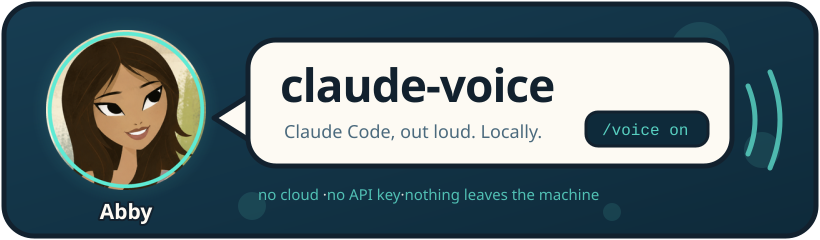

<p align="center">
  <a href="https://traxdata313.github.io/claude-voice/" title="Hear her speak">
    
  </a>
</p>

<p align="center">
  <em>Your terminal grew a voice. It runs on your own machine and tells nobody about it.</em><br>
  <a href="https://traxdata313.github.io/claude-voice/"><strong>▶&nbsp; Demo — hear Abby, Neya and Max</strong></a>
</p>

<p align="center">
  <a href="https://traxdata313.github.io/claude-voice/" title="Hear her speak"></a><br>
  <em><strong>Abby</strong>, as claude-voice — click her to hear her speak.</em><br>
  <sub> English and  Russian
  are tested on Qwen; 🌐 most widely used languages should read normally. <a href="docs/languages.md">More →</a></sub>
</p>

---

**Abby narrates Claude Code and [Codex](docs/codex.md) answers** through a speech model on your own machine —
totally free: no cloud, no API key, no account, no audio ever leaving the computer. Unplug
the network and she carries on talking.

She reads a long answer as its `## TL;DR` rather than in full, and Claude is told to write one.
**[How she decides what to say →](docs/writing-for-the-ear.md)**

## Easy install

Windows only. Paste this into Claude Code:

```
Clone https://github.com/TraxData313/claude-voice here, then follow docs/tour.md
in it: set it up, turn it on, and give me the spoken tour.
```

Or in PowerShell, no clone:

```powershell
powershell -c "irm https://raw.githubusercontent.com/TraxData313/claude-voice/main/install.ps1 | iex"
```

Either way it becomes a program: **Abby for Claude** in the Start menu, an Uninstall in
Settings → Apps, no admin rights, fine with Smart App Control. Also as a Claude Code plugin.
**[What it does →](docs/install.md)**

## What it needs

| | |
|---|---|
| **Windows** | there is no macOS or Linux build. Python comes with it: a private, signed python.org copy |
| **Nothing else, for Pocket** | the default engine: the CPU, a few hundred MB, Abby in English |
| **An NVIDIA card, for Qwen** | ~4 GB of video memory (an estimate) and 3 GB of disk; reads every alphabet. Not with Smart App Control on |

**[Three engines, and what each costs →](docs/engines.md)**

## Usage cheatsheet

`/voice <thing>` in Claude Code. Mind the space: `/voice on`, never `/voice_on`.

| | |
|---|---|
| `on` / `off` | the switch. `off` leaves the engine warm, so `on` is instant |
| `set abby` | change voice. Any unambiguous substring: `set ab` works |
| `engine pocket` | which engine speaks: `qwen`, `pocket` or `breeze`. [Engines →](docs/engines.md) |
| `repeat` | say the last answer again. `repeat-all` for the whole thing |
| `stop` / `pause` / `play` | cut it off and empty the queue · hold her mid-word · carry on |
| `volume 40` | how loud, 0 to 100 — audible mid-sentence |
| `narrate transcript on` | also hear the short lines between tool calls; then `hooks install`. Off by default |
| `panel` | the window: who speaks, pause, skip, volume, history. **[All of it →](docs/panel.md)** |
| `update` | is there a newer one? It only ever looks when you ask |
| `help` | every command, grouped. **[All of them →](docs/commands.md)** |

## The voices

Three ship with it, all the author's own — original characters, borrowed from nobody:

| | | |
|---|---|---|
|  | **Abby** | Cute, slightly nerdy, young and warm. Calm, never in a hurry — for careful work, tricky debugging, and being talked through something gently. |
|  | **Neya** | Soft-spoken, emotionally intuitive, young and calming. Grounded and gently reassuring — for thoughtful deep dives, empathetic listening, and navigating complex ideas at a comfortable pace. |
|  | **Max** | Brave and driving, a trainer's energy. Punchy lines, counts off what is done, pushes for one more — for grinding through a long list. |

▶ **[Hear all three](https://traxdata313.github.io/claude-voice/)** — GitHub will not play
audio inside a README. **[Cloning your own, and whose voice you may publish →](docs/voices.md)**

> *With thanks to **Genndy Tartakovsky**, whose* Samurai Jack *is why they look the way they
> do. The characters are ours; the debt is to the style, and to the spirit of the thing.*

## Where the detail lives

| | |
|---|---|
| **[Install →](docs/install.md)** | what the installer does, where it puts things, Smart App Control, removing it |
| **[Updating →](docs/updating.md)** | getting a newer one, and exactly what the version check sends |
| **[How it works →](docs/how-it-works.md)** | the engine, the hooks, the JNI bridge — and the things that cost real time to find |
| **[How a game finds it →](docs/discovery.md)** | the registry key, where.json, and the order a program looks in |
| **[Talking to her from a program →](docs/api.md)** | the HTTP API — and [what a game needs](docs/api.md#for-a-game) |
| **[When it goes quiet →](docs/troubleshooting.md)** | silence has no error message. Start here |

<!-- ─────────────────────────────────────────────────────────────────────────
     AUTHOR'S SECTION — copied verbatim from github.com/TraxData313/ImmersiveAI
     Hands off. Only TraxData313 changes the wording below.
     ───────────────────────────────────────────────────────────────────────── -->

## Freely given

- **Public domain** — no license, no strings, no permission to ask ([The Unlicense](LICENSE)).
  Use it, share it, change it, sell it. *"Freely you have received; freely give."* (The bundled
  Harmony library keeps its own MIT notice in `lib\`.)
- **Want to help?** Give feedback and report bugs.
- **No donations** — this is a hobby, done for fun and out of good will; I want to keep money
  out of it. *"For the love of money is the root of all evil."*
- If you still insist on thanking me somehow — visit [my GitHub acc](https://github.com/TraxData313) and read my top pinned

<p align="center">
  
</p>

<!-- ── end author's section ── -->
