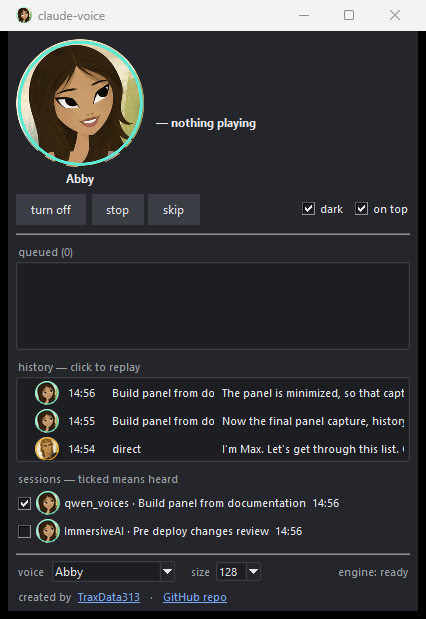

# The panel

  

**Abby for Claude** in the Start menu, or `/voice panel`. It owns nothing: it asks the engine
what is happening twice a second and draws the answer, so closing it changes nothing else.

- **Who is speaking**, what they are saying, and which project it came from. Click her portrait
  to hear one known line; right-click it to swap voice.
- **A switch to load the engine or hand its memory back**, and **⏸ pause / ▶ play** — green
  while working, red while not, grey while the engine is still loading. Then **⏩ skip line ·
  ⏭ skip all** and a **volume** slider that bites mid-sentence. Rest on any of them and it says
  what it does.
- **Pause really pauses.** It stops mid-word and carries on from that word, and nothing is lost
  while it is held: the queue goes on filling and the engine keeps its model. The **play/pause
  key** on a keyboard or headphones works it too, and is given back the moment she has nothing
  to say.
- **+ on the queue**: type any text and it is read out, behind whatever is already waiting.
- **History**: click any line to hear it again, from the audio you already heard.
- **A tick per session**: untick one and it stops being read aloud. A session appears once its
  hooks have spoken to the engine — after a restart of the engine, at its next prompt.
- **Three bars, top left**, open Settings. Each tick has a line saying what it does: **start
  with Windows** opens the panel when you log in, **auto start engine** loads it and turns the
  voice on as the panel opens; both together and you press nothing at all.
- Voice, portrait size, **dark**, **on top** (off by default), and Abby along the bottom.

When the engine had to change course — Smart App Control refused Qwen, or the port it wanted
was taken — the status line says so in a few words, and resting on it gives the whole sentence.

**[How it was built, and what changed on the way →](panel-plan.md)**
